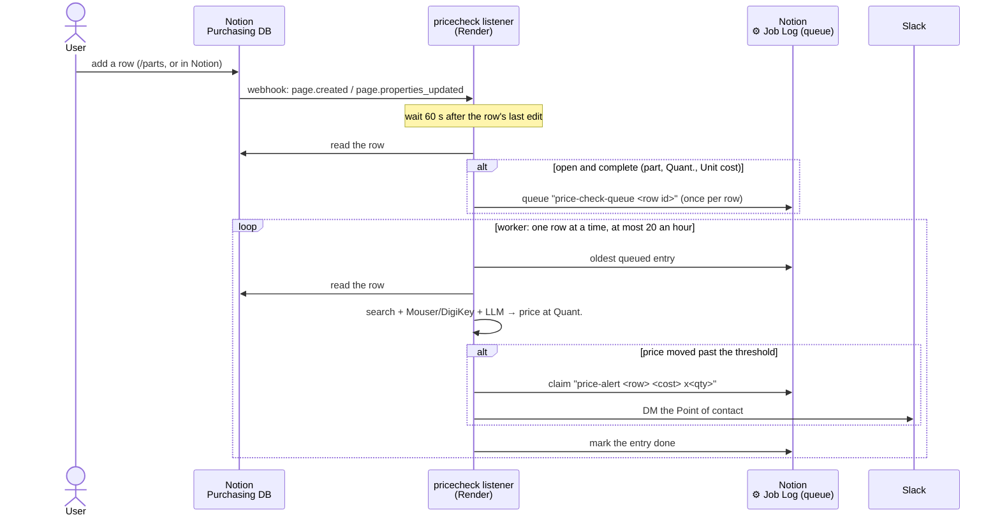

# PER Purchasing price check

Watches the Purchasing (PEFS) Notion database and, when a new row's price has
moved, DMs the person who ordered it on Slack. Rows can come from anywhere:
PERBot's `/parts`, typed into Notion, or imported. Each new row is re-priced at
its quantity (web search, Mouser/DigiKey APIs and an LLM reading the product
pages) and compared with the `Unit cost` in Notion.

```
Notion row added or edited
  → webhook → pricecheck (python -m pricecheck)
  → wait for edits to settle → queue in PERBot's Job Log
  → worker: search + Mouser/DigiKey + LLM → price at Quant.
  → price moved past the threshold → Slack DM to the Point of contact
```



## How it works

`pricecheck/listener.py` is the app (`python -m pricecheck`): a small web server that Notion's webhooks call
when a page is created or edited. Everything else runs from there.

1. **Settle:** a row is read 60 s (`PRICE_LISTENER_SETTLE_SECONDS`) after its
   *last* event, so a row typed in by hand (created empty, then filled in field
   by field) is looked at once, complete. Only edits to price-relevant columns
   count (part number, `Quant.`, `Unit cost`, link, `Season`, `Exported?`,
   notes), and other databases' events are ignored.
2. **Queue:** if it's open and complete, it's queued in PERBot's ⚙️ Job Log as
   `price-check-queue <page id>`, the same entry PERBot's `/parts` writes, so a
   row is queued once however many events or apps report it.
3. **Check:** one worker drains the queue one row at a time, at most 20 an
   hour (`PRICE_LISTENER_MAX_PER_HOUR`) with the LLM paced per minute on top,
   and marks each entry done (`price-check-done`). A burst of 100 new rows
   waits its turn instead of hitting the search and LLM limits at once. If
   search or the LLM is failing (quota, outage), the row stays queued and the
   worker backs off 10 min, 20 min, ... up to 6 h.

The queue lives in Notion, so a restart loses nothing that was queued. On
startup the listener also queues complete rows created in the last
`PRICE_CHECK_LOOKBACK_HOURS` (default a week) that were never queued, which
covers anything added while it was down.

**Which rows are checked:** this season's (`BENBUYS_SEASON`, default `REV12`)
rows with `Exported?` unchecked and a `Cat. or model no.`, `Quant.` and
`Unit cost`; queued rows that don't qualify are dropped from the queue.

**The check:** the row's `Link to product webpage` is read first, and the
manufacturer part number shown there (e.g. `Texas Instruments LM7805CT/NOPB`) is
what gets searched; `Cat. or model no.` is only the fallback when there's no link,
it can't be read, or it shows no part number, since that column is often a
description ("M3 screws"). `scrapers.find` (the LLM scraper) searches it at that
quantity (web + Mouser/DigiKey APIs + LLM). The price at that link is used if it could be
read, else the best-ranked option, at the price break the quantity reaches.
A listing that's out of stock (or has less than `Quant.`) never drives an alert:
if your link is out of stock, the best in-stock option is compared instead and
the DM says why ("Your link: out of stock"). If nothing in stock was found,
there's no alert. When a page doesn't show stock at all, the DM flags it.
Rows written by `/parts` as packs ("Sold in packs of N" in the notes) are
compared per unit. It alerts when the unit price differs from `Unit cost` by at
least `PRICE_CHECK_THRESHOLD_PCT` (default 10) and the order total by at least
`PRICE_CHECK_MIN_DELTA_USD` (default 0).

**Who gets it:** Notion person → Slack user by email, then an unambiguous name
match (as PERBot's `identity.ts`). No match → `PRICE_CHECK_CHANNEL` if set,
else the log. Each alert is recorded once in the Job Log as
`price-alert <row id> <unit cost> x<quant>`, so a row alerts again only after
its `Unit cost` or `Quant.` changes.

**Buttons:** the DM has **Use $X** for the price found (and for a cheaper
option, unless it's flagged) and **Keep $Y**. Clicks go to PERBot, not this
service, because the DM is sent with PERBot's bot token. PERBot re-reads the row,
writes `Unit cost` (and the product link when the option is a different listing)
only if the row hasn't changed since the alert, notes it in `Notes (internal)`
and offers Undo. Each option also gets a **View <supplier> ↗** link button, and
Use asks for a confirmation (check the listing first: right part, in stock, this
price), so a person looks at the listing before Notion changes. Block/action ids and button values are a contract with PERBot's
`src/priceCheck/blocks.ts`; change both together.

**Savings ledger:** each alert that's sent is also logged as a Pending row in
💸 Price Check Savings (Notion, under Purchasing — PEFS), with the old price, the
price offered and `Potential $ = (old − offered) × Quant.`. PERBot fills in the
outcome when someone clicks (Used / Kept / Undone), sets `Saved $`, and marks a
row Realized once it's ordered at the new price. `/pricecheck` in Slack sums it
up (this season, `week`, or `all`). A failed ledger write never stops an alert.

**Sharing PERBot's tokens:** Notion and Slack let both apps use the same tokens
at once; their rate limits are shared. A rate-limited call (HTTP 429) waits for
the `Retry-After` time and tries again, up to 3 times.

## Setup

To run it locally first: `pip install -r requirements.txt`, copy `.env.example`
to `.env` and fill in the settings below, then
`python -m pricecheck.check --row <notion page url> --dry-run -v` checks one row
without sending or writing anything.

It runs on Render as a web service (`render.yaml`), next to PERBot.

1. **Push** this repo to GitHub (`main`).
2. **Create the service:** Render → **New → Blueprint** → connect
   `Penn-Electric-Racing/PER-Purchasing`. Render reads `render.yaml` and sets up
   `per-price-listener` on the starter plan (about $7/month; a free instance
   sleeps after 15 minutes idle, which pauses the checks).
3. **Fill in the keys it asks for:** `NOTION_TOKEN` and `SLACK_BOT_TOKEN`
   (copy them from PERBot's Render service → Environment), `SERPER_API_KEY`,
   `GEMINI_API_KEY`, and optionally the Mouser/DigiKey/Groq keys and
   `PRICE_CHECK_CHANNEL`. Leave `NOTION_WEBHOOK_SECRET` empty for now.
4. **Check it's up:** `https://per-price-listener.onrender.com/healthz` returns
   `{"ok": true, ...}`. The service's **Logs** show the startup catch-up.
5. **Add the Notion webhook:** notion.so/profile/integrations → PERBot's
   integration (the one `NOTION_TOKEN` belongs to) → **Webhooks** → create a
   subscription to `https://per-price-listener.onrender.com/notion/webhook`
   with the events `page.created` and `page.properties_updated`.
6. **Verify it:** the listener's Logs show "verification token received" and
   a value starting `secret_`. Paste it into Notion's **Verify** box, then set
   it as `NOTION_WEBHOOK_SECRET` in Render → Environment (the service restarts).
   Every event's signature is checked against it.
7. **Try it:** add a `REV12` Purchasing row with you as Point of contact and a
   deliberately wrong `Unit cost`. About a minute after your last edit the Logs
   show it queued and checked, and PERBot DMs you.

Pushes to `main` redeploy automatically. Settings changes go in Render →
Environment.

PERBot needs no changes: its `/parts` rows arrive as webhook events like any
other. (Its optional `PRICE_CHECK_QUEUE` hook just queues them a minute sooner.)

## Settings

Set these on the host (Render → Environment) or in `.env` locally. The names
match PERBot's, so the same values work in both.

| Variable | Default | What it does |
|---|---|---|
| `NOTION_TOKEN` (or `NOTION_API_KEY`) | required | PERBot's Notion integration token |
| `SLACK_BOT_TOKEN` | required | PERBot's bot token (`chat:write`, `users:read`, `users:read.email`) |
| `NOTION_WEBHOOK_SECRET` | required | The webhook subscription's verification token |
| `SERPER_API_KEY` / `BRAVE_API_KEY` | one required | Web search (DuckDuckGo blocks cloud servers) |
| `GEMINI_API_KEY` / `GROQ_API_KEY` / `OPENROUTER_API_KEY` | one required | LLM that reads product pages |
| `MOUSER_API_KEY`, `DIGIKEY_CLIENT_ID` + `DIGIKEY_CLIENT_SECRET` | optional | Exact distributor prices and stock |
| `PRICE_CHECK_THRESHOLD_PCT` | `10` | Alert when the unit price moved at least this much (%) |
| `PRICE_CHECK_MIN_DELTA_USD` | `0` | ...and the order total moved at least this much ($) |
| `PRICE_CHECK_CHANNEL` | none | Post here when the Point of contact has no Slack match |
| `PRICE_LISTENER_SETTLE_SECONDS` | `60` | Wait this long after a row's last edit |
| `PRICE_LISTENER_MAX_PER_HOUR` | `20` | Rows checked per hour at most |
| `PRICE_CHECK_LOOKBACK_HOURS` | `168` | On startup, catch up on rows created this recently |
| `PRICE_CHECK_LEDGER_DS_ID` | PERBot's | 💸 Price Check Savings data source; empty turns the ledger off |
| `PRICE_CHECK_POOL` | `15` | Search results read per row |
| `BENBUYS_SEASON` | `REV12` | Only this season's rows are checked |
| `BENBUYS_PURCHASING_DS_ID`, `NOTION_JOB_LOG_DS_ID`, `NOTION_API_VERSION` | PERBot's | Which databases to use |
| `PORT` | `8080` | Set by Render |

## Manual commands

```bash
python -m pricecheck --dry-run                          # run the listener, log alerts, write nothing
python -m pricecheck.check --queue --dry-run -v         # one pass: new rows + queue, nothing written
python -m pricecheck.check --enqueue <notion page url>  # queue a row by hand (e.g. one typed in Notion)
python -m pricecheck.check --row <notion page url>      # check one row now
python -m pricecheck.check --all --dry-run -v           # every open row, print alerts only
```

## Part search (`scrapers/`)

The price check is built on these. They also work on their own as a
command-line part finder.

Find the best places to buy an electronic part (or anything else sold online).
Give it a part number and a quantity. It searches the web, reads about 30
listings, works out what your order would cost from each one, including pack
sizes, bulk pricing and shipping, and ranks the best 5.

```
$ python -m scrapers.regex_scraper "LM7805" -q 50
Best 5 of 30 results for "LM7805"  x50  (via serper; 27 pages read, 22 with prices; ranked by best)

1. LM7805CT/NOPB Texas Instruments | Mouser
   https://www.mouser.com/ProductDetail/...
   Score:         1.00  (1.00 = cheapest, no drawbacks; search rank #4)
   Supplier:      Mouser Electronics
   Cost:          0.89 USD  (json-ld)
   Price breaks:  10+ @ 0.62, 100+ @ 0.48
   Unit cost:     0.62 USD
   Buy:           50 unit(s) = 31.00 USD
   Stock:         12,400
   Shipping time: 1-2 days
   Shipping cost: Free
   Total:         31.00 USD
...
```
*(Illustrative output: real prices and results vary.)*

There are two scrapers. They share the same search and ranking code:

| | How it reads each page | Needs |
|---|---|---|
| **`regex_scraper`** | Structured product data (schema.org JSON-LD), then `<meta>` tags, then regex over the text | Nothing extra |
| **`llm_scraper`** | Sends the cleaned-up page text to a free or cheap LLM, which returns the fields as JSON | A free LLM API key, or Ollama |

`regex_scraper` is fast, free and predictable. `llm_scraper` copes better with
unusual page layouts and wording, such as conditional shipping offers, pack
sizes and price tables. It is slower, because free LLM tiers limit requests
per minute.

### Setup

```bash
python -m venv .venv && source .venv/bin/activate
pip install -r requirements.txt
```

#### API keys in `.env`

Put your keys in a `.env` file in the project folder and both scrapers load it
automatically:

```bash
cp .env.example .env    # then fill in the keys you have
```

`.env` is git-ignored. Variables already set in your shell take priority, and
blank lines in the file are ignored. You can also `export` any of the
variables below instead.

#### Search API key (recommended)

Both scrapers use the first search source that works:

| Source | Free tier | Environment variable |
|---|---|---|
| [Brave Search API](https://api.search.brave.com) | about 2,000 queries/month | `BRAVE_API_KEY` |
| [Serper.dev](https://serper.dev) (Google results) | 2,500 queries, no card | `SERPER_API_KEY` |
| Google Programmable Search | 100/day | `GOOGLE_API_KEY` + `GOOGLE_CSE_ID` |
| DuckDuckGo HTML | no key needed | none |

DuckDuckGo works without a key but rate-limits quickly (usually for 15-60
minutes), so set one of the keys if you search often.

#### Mouser and DigiKey API keys (recommended for electronic parts)

Mouser and DigiKey pages are hard to scrape, but both have free APIs that give
exact price breaks, stock, minimum order and lead time. When keys are set,
both scrapers add up to `--api` parts (default 10) from each API to the pool,
and skip scraped pages from that distributor's site.

| API | How to get a key | Environment variables |
|---|---|---|
| [Mouser Search API](https://www.mouser.com/api-hub/) | free, ~1,000 calls/day | `MOUSER_API_KEY` |
| [DigiKey Product Information v4](https://developer.digikey.com) | create an app (Production, Product Information V4), free tier | `DIGIKEY_CLIENT_ID` + `DIGIKEY_CLIENT_SECRET` |

DigiKey uses `DIGIKEY_SITE` (default `US`) and `DIGIKEY_CURRENCY` (default
`USD`). Neither API reports shipping costs, so shipping is treated as
unknown unless you set the free-shipping minimum for your country, for
example `MOUSER_FREE_SHIP_MIN=50` and `DIGIKEY_FREE_SHIP_MIN=100`. Check the
distributor's site for the current amount.

#### LLM key (only for `llm_scraper`)

| Provider | Free tier | Environment variable | Default model |
|---|---|---|---|
| [Google Gemini](https://aistudio.google.com/apikey) | yes, no card | `GEMINI_API_KEY` | `gemini-3.1-flash-lite` |
| [Groq](https://console.groq.com/keys) | yes, no card | `GROQ_API_KEY` | `qwen/qwen3.8-27b` |
| [OpenRouter](https://openrouter.ai) | `:free` models | `OPENROUTER_API_KEY` | `meta-llama/llama-3.3-70b-instruct:free` |
| [Ollama](https://ollama.com) (local) | free | none (must be running on `localhost:11434`) | `llama3.2` |

`llm_scraper` uses the first provider in this list that has a key set. You can
choose a different provider with `--provider`, and a different model with
`--model` or `LLM_MODEL=...`. If a provider says the default model doesn't
exist (free model names change often), pass a current one with `--model`.

### Usage

```bash
python -m scrapers.regex_scraper "LM7805 voltage regulator"  # best 5 for 1 unit
python -m scrapers.regex_scraper "LM7805" -q 50              # you need 50 units
python -m scrapers.regex_scraper "LM7805" --rank cheapest    # lowest order total only
python -m scrapers.regex_scraper "LM7805" --pool 50 -n 10    # compare 50 results, show 10
python -m scrapers.regex_scraper "LM7805" --json             # machine-readable output
python -m scrapers.regex_scraper "LM7805" --no-fetch         # search snippets only (fast)
python -m scrapers.regex_scraper "LM7805" --weights w.json   # custom ranking weights

export GEMINI_API_KEY=...
python -m scrapers.llm_scraper "LM7805" -q 50 -v             # same, with LLM extraction
python -m scrapers.llm_scraper "LM7805" --provider groq --rpm 30
python -m scrapers.llm_scraper "LM7805" --no-fetch           # one LLM call over all snippets
```

#### Options (both scrapers)

| Option | Default | Meaning |
|---|---|---|
| `-q, --qty N` | 1 | Units you need. Used for pack maths, bulk price tiers, stock checks and free-shipping minimums. |
| `-n, --top N` | 5 | How many options to show. |
| `--pool N` | 30 | How many search results to read and compare. |
| `--rank best\|cheapest` | `best` | `best` uses the weighted score (below); `cheapest` uses the lowest order total. |
| `--per-supplier N` | 2 | Maximum options shown from one supplier, unless that would leave fewer than `--top`. |
| `--exact` | off | Search the query exactly. By default "price" is added, and "buy …" / "… in stock" searches top up the pool. |
| `--no-fetch` | off | Don't open the result pages; use only the search titles and snippets. |
| `--weights FILE` | none | JSON file that overrides ranking weights (see below). |
| `--api N` | 10 | Parts to take from each distributor API that has keys set. `0` turns the APIs off. |
| `--json` | off | Print the full results as JSON. |
| `-v, --verbose` | off | Log skipped search sources, LLM retries and fetch errors to stderr. |

`llm_scraper` only:

| Option | Default | Meaning |
|---|---|---|
| `--provider` | first with a key | `gemini`, `groq`, `openrouter` or `ollama`. |
| `--model` | provider default | LLM model ID (or set `LLM_MODEL`). |
| `--rpm N` | 15 | Maximum LLM requests per minute, to stay inside free-tier limits. 30 pages at 15 rpm takes about 2 minutes. |

### How it works

```
search ──► fetch each page ──► extract fields ──► apply quantity ──► score ──► pick top N
(websearch)  (websearch)        regex_scraper       apply_qty          ranking
                               or llm_scraper
```

1. **Search** (`websearch.search`): gets `--pool` unique URLs from the first
   search source that works. The Mouser and DigiKey APIs (`distributors`)
   are queried too. Their results arrive with all fields filled in, so they
   skip steps 2 and 3. If web search fails, the API results are still ranked.
2. **Fetch** (`websearch._fetch_html`): downloads each page (up to 5 MB). PDFs
   and other non-HTML files are skipped. If a site blocks the request, the
   search snippet is used instead.
3. **Extract**. Each listing gets these fields: `cost`, `currency`,
   `supplier`, `stock` / `in_stock`, `shipping_cost`, `free_ship_min`,
   `shipping_time`, `price_breaks`, `price_range`, `listing_page` (a search or
   category page rather than one product), and, in `llm_scraper`,
   `pack_size`.
   - `regex_scraper`: JSON-LD → `<meta>`/microdata → regex over the text after
     the product's `<h1>` → regex over the search snippet. Each step only
     fills fields that are still empty.
   - `llm_scraper`: the page is cut down to about 8,000 characters of visible
     text around the `<h1>`. Crossed-out prices are labelled
     `[struck-out: …]`, and any JSON-LD and the search snippet are added. The
     LLM is asked for the same fields as a JSON object, and every value is
     type-checked before it is used.
4. **Quantity** (`apply_qty`): rounds `--qty` up to the distributor's minimum
   order and order multiple (API results only), then picks the bulk price tier
   that quantity reaches.
   Otherwise it divides by the pack size ("Pack of 10", "30pcs") to get packs
   needed. It then checks stock and applies the free-shipping minimum.
5. **Score and pick** (`ranking.Scorer`): see below.

### Ranking

Lower is better. **1.00** means the cheapest valid option with no drawbacks.

```
score = (effective_cost / best) × multiplier
```

- **`effective_cost`** = subtotal for your quantity + shipping. When shipping
  is unknown, the median shipping cost of the other listings is used.
- **`best`** = the lowest `effective_cost` among listings with no warning
  notes (wrong part number, variant suffix, other currency), so a wrong-part
  bargain can't set the baseline.
- **`multiplier`** = all of the factors below multiplied together:

| Condition | Factor | `Weights` field |
|---|---|---|
| Out of stock | × 1.6 | `out_of_stock` |
| Stock below `--qty` | × 1.4 | `short_stock` |
| Stock unknown | × 1.03 | `stock_unknown` |
| Ships in more than 2 days | × (1 + 0.02 × (days − 2)), at most × 1.40 | `per_ship_day`, `fast_days`, `ship_day_cap` |
| Shipping time unknown | × 1.06 | `ship_time_unknown` |
| Shipping cost unknown | × 1.04 | `ship_cost_unknown` |
| Where the price came from | api / json-ld / meta × 1.0, llm × 1.02, page text × 1.05, snippet / llm snippet × 1.15, other × 1.1 | `source`, `unknown_source` |
| Search or category page | × 1.12 | `listing_page` |
| Query words missing | × (1 + 0.6 × fraction missing) | `relevance` |
| Only a longer part number found (LM317L for LM317) | × 1.08 | `mpn_variant` |
| Unit cost below 25% of the median (once 4+ prices are known) | × 1.35 | `outlier`, `outlier_ratio`, `outlier_min_count` |
| Search position (tiebreak) | × (1 + 0.005 × rank) | `per_search_rank` |

Example: if the best option is $10 delivered, a $11 listing that ships in 5
days, with unknown stock, a price read by the LLM, at search position #3,
scores `1.1 × 1.06 × 1.03 × 1.02 × 1.015 ≈ 1.24`.

**Picking the top N** (`Scorer.pick_top`): listings are first sorted into
groups, and each group comes ahead of the next regardless of score:

1. everything not in a group below,
2. not enough stock,
3. part number not found, or priced in a different currency,
4. no price.

Within a group they are sorted by score (or by `effective_cost` with
`--rank cheapest`), with at most `--per-supplier` options from one supplier.

#### Changing the weights

Every number above is a field of the `Weights` dataclass in `scrapers/ranking.py`.
There are three ways to change them:

```python
# 1. Edit the defaults in scrapers/ranking.py

# 2. From code
from scrapers import Scorer, Weights
scorer = Scorer(Weights(out_of_stock=2.0, per_ship_day=0.05))
scorer.score_all(results, "LM7805", qty=50)
top = scorer.pick_top(results, 5)
```

```bash
# 3. Per run, with a JSON file containing only the values you want to change
cat > w.json <<'EOF'
{"out_of_stock": 2.0, "per_ship_day": 0.05, "source": {"snippet": 1.3}}
EOF
python -m scrapers.regex_scraper "LM7805" --weights w.json
```

`source` entries are merged with the defaults. Any name the file doesn't
recognise, such as a typo, stops the run with an error.

### JSON output

`--json` prints:

```json
{
  "query": "LM7805 price", "qty": 50, "source": "serper", "rank": "best",
  "candidates": 30, "fetched": 27, "priced": 22,
  "results": [ { "title": "...", "url": "...", "score": 1.0, "notes": [], ... } ]
}
```

`llm_scraper` also adds `"llm": "<provider>/<model>"`. Each result includes
every extracted field, plus `unit_cost`, `pack_size`, `packs_needed`,
`subtotal`, `total`, `effective_cost`, `enough_stock`, `ship_days`,
`relevance`, `mpn_variants`, `notes` and `fetch_error`.

## Project layout

Run everything from the project root (`python -m ...`).

```
pricecheck/            the price check app (python -m pricecheck)
  listener.py            Notion webhook server -> settle -> Job Log queue -> worker
  check.py               Checker (check one row, drain the queue) + manual CLI
  comparison.py          Unit cost vs. the prices found (Finding)
  alert.py               the Slack text of an alert
  notion.py              Notion client, Purchasing columns, rows
  joblog.py              PERBot's Job Log: the queue and alert dedup
  slack.py               Slack client, Notion person -> Slack user matching
  config.py              settings from the environment
  api.py                 retries when Notion or Slack rate limit
scrapers/              part search (also usable on its own)
  websearch.py           search backends (Brave/Serper/Google/DuckDuckGo), page fetching
  distributors.py        Mouser + DigiKey APIs, minimum-order maths
  regex_scraper.py       JSON-LD / meta / regex extraction, apply_qty, CLI
  llm_scraper.py         LLM page reading, find() (used by the price check), CLI
  ranking.py             Weights, Scorer (score_all, pick_top), relevance, ship_days
  env.py                 loads .env
tests/
  test_listener.py       webhook signature/routing, settling, rate limit, worker, end to end
  test_price_check.py    row parsing, price comparison, identity, alerts (all faked)
  test_cli.py            the scraper and price check command lines end to end
  test_regex_scraper.py  extraction, shipping, fetching and ranking regressions
  test_search.py         search backends, search(), page fetching and parsing
  test_llm_scraper.py    page cleanup, LLM reply validation, LLM client (faked)
  test_ranking.py        Weights / Scorer / --weights files
  test_distributors.py   Mouser / DigiKey parsing and ranking (APIs faked)
render.yaml            Render web service for the listener
pyproject.toml         pytest settings
requirements.txt
```

Each package's `__init__.py` lists what it exports (`__all__`), e.g.
`from scrapers import find, Scorer` or `from pricecheck import Checker, Notion`.

## Tests

All tests run offline. Network calls and the LLM are faked.

```bash
pytest            # or: .venv/bin/python -m pytest
pip install coverage && coverage run -m pytest && coverage report -m   # what's untested
```

## Limitations

- Sites that block scripts (eBay, and DigiKey without an API key) fall back to
  the search snippet, which is less reliable and is ranked lower because of that.
- Prices are compared in whatever currency each site shows. Listings in a
  different currency from most others are flagged, not converted.
- LLM extraction can still get things wrong. Check the listing before buying,
  especially when a result has notes.
- Free LLM tiers have daily request limits (for example, about 1,000 requests
  a day on Gemini Flash-Lite), so a 30-result search uses about 30 of them.
