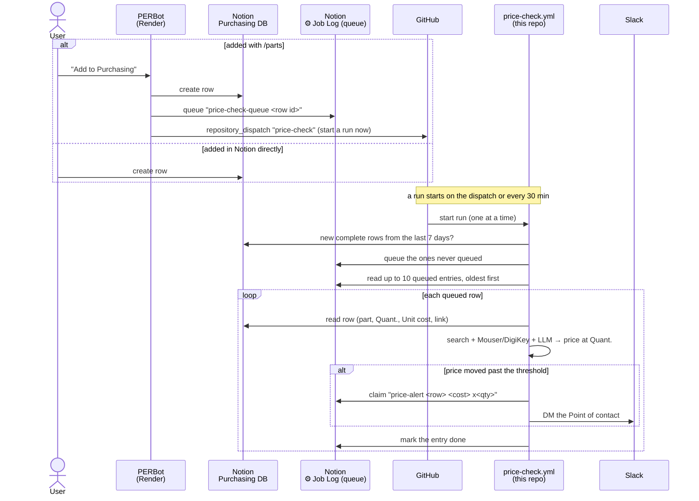

# Part price scraper

Find the best places to buy an electronic part (or anything else sold online).
Give it a part number and a quantity. It searches the web, reads about 30
listings, works out what your order would cost from each one, including pack
sizes, bulk pricing and shipping, and ranks the best 5.

```
$ python scraper.py "LM7805" -q 50
Best 5 of 30 results for "LM7805"  x50  (via serper; 27 pages read, 22 with prices; ranked by best)

1. LM7805CT/NOPB Texas Instruments | Mouser
   https://www.mouser.com/ProductDetail/...
   Score:         1.00  (1.00 = cheapest, no drawbacks; search rank #4)
   Supplier:      Mouser Electronics
   Cost:          0.89 USD  (json-ld)
   Price breaks:  10+ @ 0.62, 100+ @ 0.48
   Unit cost:     0.62 USD
   Buy:           50 unit(s) = 31.00 USD
   Stock:         12,400
   Shipping time: 1-2 days
   Shipping cost: Free
   Total:         31.00 USD
...
```
*(Illustrative output: real prices and results vary.)*

There are two scrapers. They share the same search and ranking code:

| | How it reads each page | Needs |
|---|---|---|
| **`scraper.py`** | Structured product data (schema.org JSON-LD), then `<meta>` tags, then regex over the text | Nothing extra |
| **`scraper2.py`** | Sends the cleaned-up page text to a free or cheap LLM, which returns the fields as JSON | A free LLM API key, or Ollama |

`scraper.py` is fast, free and predictable. `scraper2.py` copes better with
unusual page layouts and wording, such as conditional shipping offers, pack
sizes and price tables. It is slower, because free LLM tiers limit requests
per minute.

## Setup

```bash
python -m venv .venv && source .venv/bin/activate
pip install -r requirements.txt
```

### API keys in `.env`

Put your keys in a `.env` file in the project folder and both scrapers load it
automatically:

```bash
cp .env.example .env    # then fill in the keys you have
```

`.env` is git-ignored. Variables already set in your shell take priority, and
blank lines in the file are ignored. You can also `export` any of the
variables below instead.

### Search API key (recommended)

Both scrapers use the first search source that works:

| Source | Free tier | Environment variable |
|---|---|---|
| [Brave Search API](https://api.search.brave.com) | about 2,000 queries/month | `BRAVE_API_KEY` |
| [Serper.dev](https://serper.dev) (Google results) | 2,500 queries, no card | `SERPER_API_KEY` |
| Google Programmable Search | 100/day | `GOOGLE_API_KEY` + `GOOGLE_CSE_ID` |
| DuckDuckGo HTML | no key needed | none |

DuckDuckGo works without a key but rate-limits quickly (usually for 15-60
minutes), so set one of the keys if you search often.

### Mouser and DigiKey API keys (recommended for electronic parts)

Mouser and DigiKey pages are hard to scrape, but both have free APIs that give
exact price breaks, stock, minimum order and lead time. When keys are set,
both scrapers add up to `--api` parts (default 10) from each API to the pool,
and skip scraped pages from that distributor's site.

| API | How to get a key | Environment variables |
|---|---|---|
| [Mouser Search API](https://www.mouser.com/api-hub/) | free, ~1,000 calls/day | `MOUSER_API_KEY` |
| [DigiKey Product Information v4](https://developer.digikey.com) | create an app (Production, Product Information V4), free tier | `DIGIKEY_CLIENT_ID` + `DIGIKEY_CLIENT_SECRET` |

DigiKey uses `DIGIKEY_SITE` (default `US`) and `DIGIKEY_CURRENCY` (default
`USD`). Neither API reports shipping costs, so shipping is treated as
unknown unless you set the free-shipping minimum for your country, for
example `MOUSER_FREE_SHIP_MIN=50` and `DIGIKEY_FREE_SHIP_MIN=100`. Check the
distributor's site for the current amount.

### LLM key (only for `scraper2.py`)

| Provider | Free tier | Environment variable | Default model |
|---|---|---|---|
| [Google Gemini](https://aistudio.google.com/apikey) | yes, no card | `GEMINI_API_KEY` | `gemini-3.1-flash-lite` |
| [Groq](https://console.groq.com/keys) | yes, no card | `GROQ_API_KEY` | `qwen/qwen3.8-27b` |
| [OpenRouter](https://openrouter.ai) | `:free` models | `OPENROUTER_API_KEY` | `meta-llama/llama-3.3-70b-instruct:free` |
| [Ollama](https://ollama.com) (local) | free | none (must be running on `localhost:11434`) | `llama3.2` |

`scraper2.py` uses the first provider in this list that has a key set. You can
choose a different provider with `--provider`, and a different model with
`--model` or `LLM_MODEL=...`. If a provider says the default model doesn't
exist (free model names change often), pass a current one with `--model`.

## Usage

```bash
python scraper.py "LM7805 voltage regulator"      # best 5 for 1 unit
python scraper.py "LM7805" -q 50                  # you need 50 units
python scraper.py "LM7805" --rank cheapest        # lowest order total only
python scraper.py "LM7805" --pool 50 -n 10        # compare 50 results, show 10
python scraper.py "LM7805" --json                 # machine-readable output
python scraper.py "LM7805" --no-fetch             # search snippets only (fast)
python scraper.py "LM7805" --weights w.json       # custom ranking weights

export GEMINI_API_KEY=...
python scraper2.py "LM7805" -q 50 -v              # same, with LLM extraction
python scraper2.py "LM7805" --provider groq --rpm 30
python scraper2.py "LM7805" --no-fetch            # one LLM call over all snippets
```

### Options (both scrapers)

| Option | Default | Meaning |
|---|---|---|
| `-q, --qty N` | 1 | Units you need. Used for pack maths, bulk price tiers, stock checks and free-shipping minimums. |
| `-n, --top N` | 5 | How many options to show. |
| `--pool N` | 30 | How many search results to read and compare. |
| `--rank best\|cheapest` | `best` | `best` uses the weighted score (below); `cheapest` uses the lowest order total. |
| `--per-supplier N` | 2 | Maximum options shown from one supplier, unless that would leave fewer than `--top`. |
| `--exact` | off | Search the query exactly. By default "price" is added, and "buy …" / "… in stock" searches top up the pool. |
| `--no-fetch` | off | Don't open the result pages; use only the search titles and snippets. |
| `--weights FILE` | none | JSON file that overrides ranking weights (see below). |
| `--api N` | 10 | Parts to take from each distributor API that has keys set. `0` turns the APIs off. |
| `--json` | off | Print the full results as JSON. |
| `-v, --verbose` | off | Log skipped search sources, LLM retries and fetch errors to stderr. |

`scraper2.py` only:

| Option | Default | Meaning |
|---|---|---|
| `--provider` | first with a key | `gemini`, `groq`, `openrouter` or `ollama`. |
| `--model` | provider default | LLM model ID (or set `LLM_MODEL`). |
| `--rpm N` | 15 | Maximum LLM requests per minute, to stay inside free-tier limits. 30 pages at 15 rpm takes about 2 minutes. |

## How it works

```
search ──► fetch each page ──► extract fields ──► apply quantity ──► score ──► pick top N
(scraper)   (scraper)          scraper.py: regex   apply_qty          ranking.py
                               scraper2.py: LLM
```

1. **Search** (`scraper.search`): gets `--pool` unique URLs from the first
   search source that works. The Mouser and DigiKey APIs (`distributors.py`)
   are queried too. Their results arrive with all fields filled in, so they
   skip steps 2 and 3. If web search fails, the API results are still ranked.
2. **Fetch** (`scraper._fetch_html`): downloads each page (up to 5 MB). PDFs
   and other non-HTML files are skipped. If a site blocks the request, the
   search snippet is used instead.
3. **Extract**. Each listing gets these fields: `cost`, `currency`,
   `supplier`, `stock` / `in_stock`, `shipping_cost`, `free_ship_min`,
   `shipping_time`, `price_breaks`, `price_range`, `listing_page` (a search or
   category page rather than one product), and, in `scraper2.py`,
   `pack_size`.
   - `scraper.py`: JSON-LD → `<meta>`/microdata → regex over the text after
     the product's `<h1>` → regex over the search snippet. Each step only
     fills fields that are still empty.
   - `scraper2.py`: the page is cut down to about 8,000 characters of visible
     text around the `<h1>`. Crossed-out prices are labelled
     `[struck-out: …]`, and any JSON-LD and the search snippet are added. The
     LLM is asked for the same fields as a JSON object, and every value is
     type-checked before it is used.
4. **Quantity** (`apply_qty`): rounds `--qty` up to the distributor's minimum
   order and order multiple (API results only), then picks the bulk price tier
   that quantity reaches.
   Otherwise it divides by the pack size ("Pack of 10", "30pcs") to get packs
   needed. It then checks stock and applies the free-shipping minimum.
5. **Score and pick** (`ranking.Scorer`): see below.

## Ranking

Lower is better. **1.00** means the cheapest valid option with no drawbacks.

```
score = (effective_cost / best) × multiplier
```

- **`effective_cost`** = subtotal for your quantity + shipping. When shipping
  is unknown, the median shipping cost of the other listings is used.
- **`best`** = the lowest `effective_cost` among listings with no warning
  notes (wrong part number, variant suffix, other currency), so a wrong-part
  bargain can't set the baseline.
- **`multiplier`** = all of the factors below multiplied together:

| Condition | Factor | `Weights` field |
|---|---|---|
| Out of stock | × 1.6 | `out_of_stock` |
| Stock below `--qty` | × 1.4 | `short_stock` |
| Stock unknown | × 1.03 | `stock_unknown` |
| Ships in more than 2 days | × (1 + 0.02 × (days − 2)), at most × 1.40 | `per_ship_day`, `fast_days`, `ship_day_cap` |
| Shipping time unknown | × 1.06 | `ship_time_unknown` |
| Shipping cost unknown | × 1.04 | `ship_cost_unknown` |
| Where the price came from | api / json-ld / meta × 1.0, llm × 1.02, page text × 1.05, snippet / llm snippet × 1.15, other × 1.1 | `source`, `unknown_source` |
| Search or category page | × 1.12 | `listing_page` |
| Query words missing | × (1 + 0.6 × fraction missing) | `relevance` |
| Only a longer part number found (LM317L for LM317) | × 1.08 | `mpn_variant` |
| Unit cost below 25% of the median (once 4+ prices are known) | × 1.35 | `outlier`, `outlier_ratio`, `outlier_min_count` |
| Search position (tiebreak) | × (1 + 0.005 × rank) | `per_search_rank` |

Example: if the best option is $10 delivered, a $11 listing that ships in 5
days, with unknown stock, a price read by the LLM, at search position #3,
scores `1.1 × 1.06 × 1.03 × 1.02 × 1.015 ≈ 1.24`.

**Picking the top N** (`Scorer.pick_top`): listings are first sorted into
groups, and each group comes ahead of the next regardless of score:

1. everything not in a group below,
2. not enough stock,
3. part number not found, or priced in a different currency,
4. no price.

Within a group they are sorted by score (or by `effective_cost` with
`--rank cheapest`), with at most `--per-supplier` options from one supplier.

### Changing the weights

Every number above is a field of the `Weights` dataclass in `ranking.py`.
There are three ways to change them:

```python
# 1. Edit the defaults in ranking.py

# 2. From code
from ranking import Scorer, Weights
scorer = Scorer(Weights(out_of_stock=2.0, per_ship_day=0.05))
scorer.score_all(results, "LM7805", qty=50)
top = scorer.pick_top(results, 5)
```

```bash
# 3. Per run, with a JSON file containing only the values you want to change
cat > w.json <<'EOF'
{"out_of_stock": 2.0, "per_ship_day": 0.05, "source": {"snippet": 1.3}}
EOF
python scraper.py "LM7805" --weights w.json
```

`source` entries are merged with the defaults. Any name the file doesn't
recognise, such as a typo, stops the run with an error.

## JSON output

`--json` prints:

```json
{
  "query": "LM7805 price", "qty": 50, "source": "serper", "rank": "best",
  "candidates": 30, "fetched": 27, "priced": 22,
  "results": [ { "title": "...", "url": "...", "score": 1.0, "notes": [], ... } ]
}
```

`scraper2.py` also adds `"llm": "<provider>/<model>"`. Each result includes
every extracted field, plus `unit_cost`, `pack_size`, `packs_needed`,
`subtotal`, `total`, `effective_cost`, `enough_stock`, `ship_days`,
`relevance`, `mpn_variants`, `notes` and `fetch_error`.

## Purchasing price check (`price_check.py`)

Re-prices new rows in the Purchasing (PEFS) Notion database, however they were
added (PERBot's `/parts`, typed into Notion, imported), and DMs the row's
**Point of contact** on Slack when the price moved. No column is added to the
database, and rows created before the check was set up are left alone.



**How rows get queued:** the queue is PERBot's ⚙️ Job Log, one
`price-check-queue <page id>` entry per row. Rows get there two ways, and the
shared key means a row is never queued twice:

- **Every run** of `.github/workflows/price-check.yml` (every 30 minutes) first
  looks for open, complete rows created in the last `PRICE_CHECK_LOOKBACK_HOURS`
  (default 168, a week) and queues any that were never queued. This catches
  rows added in Notion directly. A row typed in by hand is queued once it has a
  part number, `Quant.` and `Unit cost`.
- **PERBot's `/parts`** "Add to Purchasing" queues its row straight away
  (`src/partFinder/priceCheck.ts`) and sends this repo a GitHub
  `repository_dispatch`, which starts a run immediately instead of waiting for
  the schedule.

Each run (`price_check.py --queue`) then checks up to `PRICE_CHECK_BATCH`
queued rows (default 10), oldest first, one at a time, and marks each entry
done (its Job becomes `price-check-done`; the entry stays as the record that
the row was seen). Runs never overlap. A burst of 100 new rows is worked
through 10 per run instead of hitting the search and LLM limits at once. If
search or the LLM is failing (quota, outage), entries stay queued and the run
stops after 3 such rows.

**Which rows are checked:** this season's (`BENBUYS_SEASON`, default `REV12`)
rows with `Exported?` unchecked and a `Cat. or model no.`, `Quant.` and
`Unit cost`; queued rows that don't qualify are dropped from the queue.

**The check:** `scraper2.find` searches the part number at that quantity
(web + Mouser/DigiKey APIs + LLM), always reading the row's
`Link to product webpage` too. The price at that link is used if it could be
read, else the best-ranked option, at the price break the quantity reaches.
Rows written by `/parts` as packs ("Sold in packs of N" in the notes) are
compared per unit. It alerts when the unit price differs from `Unit cost` by at
least `PRICE_CHECK_THRESHOLD_PCT` (default 10) and the order total by at least
`PRICE_CHECK_MIN_DELTA_USD` (default 0).

**Who gets it:** Notion person → Slack user by email, then an unambiguous name
match (as PERBot's `identity.ts`). No match → `PRICE_CHECK_CHANNEL` if set,
else the log. Each alert is recorded once in the Job Log as
`price-alert <row id> <unit cost> x<quant>`, so a row alerts again only after
its `Unit cost` or `Quant.` changes.

It uses PERBot's environment names: `NOTION_TOKEN` (or `NOTION_API_KEY`),
`SLACK_BOT_TOKEN`, `BENBUYS_PURCHASING_DS_ID`, `NOTION_JOB_LOG_DS_ID`,
`NOTION_API_VERSION`, with PERBot's defaults.

### Setting it up

1. **This repo** (Settings → Secrets and variables → Actions): add the secrets
   the workflow lists (`NOTION_API_KEY`, `SLACK_BOT_TOKEN`, a search key such as
   `SERPER_API_KEY`, an LLM key, the distributor keys), and optionally the
   thresholds as variables.
2. **A GitHub token for PERBot:** a fine-grained personal access token with
   access to only this repo and **Contents: Read and write** (what
   `repository_dispatch` needs).
3. **PERBot's Render service:** set `PRICE_CHECK_QUEUE=true` and
   `PRICE_CHECK_DISPATCH_TOKEN=<that token>`
   (`PRICE_CHECK_DISPATCH_REPO` defaults to `pandabear189/PER-Purchase-Testing`).
   Without these, `/parts` rows are still found by the 30-minute run, just later.

### Manual commands

```bash
python price_check.py --queue --dry-run -v         # preview: new rows + queue, nothing sent or written
python price_check.py --enqueue <notion page url>  # queue a row by hand (e.g. one typed in Notion)
python price_check.py --row <notion page url>      # check one row now
python price_check.py --all --dry-run -v           # every open row, print alerts only
```

## Project layout

```
scraper.py         search backends, page fetching, regex/JSON-LD extraction, CLI
scraper2.py        LLM client + LLM extraction; reuses search from scraper.py
distributors.py    Mouser + DigiKey API lookups, minimum-order maths
price_check.py     Purchasing (Notion) price check + Slack alerts; drains PERBot's queue
.github/workflows/price-check.yml   runs it every 30 min + on PERBot's dispatch
ranking.py         Weights, Scorer (score_all, pick_top), relevance, ship_days
tests/
  test_scraper.py    extraction, shipping, fetching and ranking regressions
  test_search.py     search backends (Brave/Serper/Google/DuckDuckGo), search(), page parsing
  test_cli.py        scraper.py / scraper2.py / price_check.py command lines end to end
  test_scraper2.py   page cleanup, LLM reply validation, LLM client (faked)
  test_ranking.py    Weights / Scorer / --weights files
  test_distributors.py  Mouser / DigiKey parsing and ranking (APIs faked)
  test_price_check.py   row parsing, price comparison, identity, alerts (all faked)
requirements.txt
```

## Tests

All tests run offline. Network calls and the LLM are faked.

```bash
pytest            # or: .venv/bin/python -m pytest tests
pip install coverage && coverage run -m pytest && coverage report -m   # what's untested
```

## Limitations

- Sites that block scripts (eBay, and DigiKey without an API key) fall back to
  the search snippet, which is less reliable and is ranked lower because of that.
- Prices are compared in whatever currency each site shows. Listings in a
  different currency from most others are flagged, not converted.
- LLM extraction can still get things wrong. Check the listing before buying,
  especially when a result has notes.
- Free LLM tiers have daily request limits (for example, about 1,000 requests
  a day on Gemini Flash-Lite), so a 30-result search uses about 30 of them.
